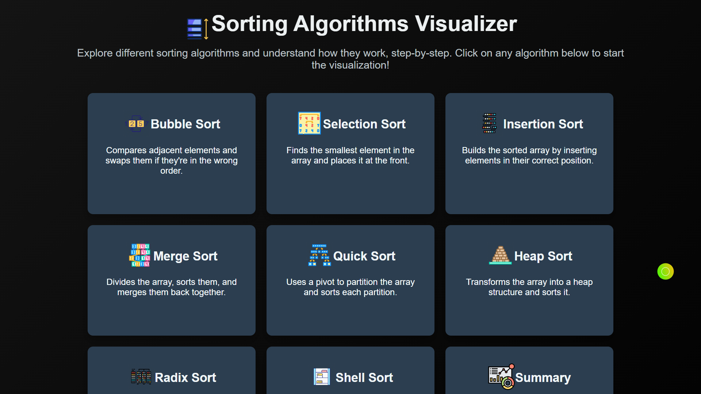

EasySorting
===========

A free, interactive, open-source sorting algorithm visualizer with eight
complete visualizations, an interactive guide hub, a live algorithm race,
a heap builder, and a Big O notation explainer. No sign-up, no frameworks,
no runtime dependencies. Just open the page in any browser and start
learning.



Visit the live site:
**[https://easysorting.netlify.app/](https://easysorting.netlify.app/)**

What you get
------------

**Visualize all 8 classic algorithms**

- Bubble Sort
- Selection Sort
- Insertion Sort
- Merge Sort
- Quick Sort (first/last/median pivot)
- Heap Sort (max-heap build)
- Radix Sort (LSD, base-10)
- Shell Sort (Knuth gap sequence)

**Learn by doing**

- Enter your own array or generate a random one.
- Step through or play at 16x speed.
- Read every algorithm's history, complexity, advantages, and disadvantages
  right on the page.
- Copy ready-to-run code in C, C++, Java, Python, and JavaScript.
- Print any page cleanly for study or notes.

**New guide and tool pages**

- [**Which Sorting Algorithm Should I Use?**](https://easysorting.netlify.app/sorting-algorithms)
  Interactive decision guide with cards, chips, growth chart, and comparison
  table.
- [**Big O Notation**](https://easysorting.netlify.app/big-o-notation)
  Six growth classes, animated curve, operation and complexity tables.
- [**Sorting Algorithm Race**](https://easysorting.netlify.app/sorting-algorithm-race)
  Live benchmark measuring comparisons, moves, and wall-clock time.
- [**Heap Visualizer**](https://easysorting.netlify.app/heap-visualizer)
  Animated max-heap and min-heap tree builder.
- [**Complexity Summary**](https://easysorting.netlify.app/summary)
  Full comparison table with interactive spotlight mode.

**Full offline and installable PWA**

Every page, image, and JavaScript asset is pre-cached the first time the
site is visited. After that the app works without any network connection.
Install it like a native app on Android, iOS, Windows, or Mac and launch
it from the home screen.

Quick start
-----------

No build step required.

```
# Clone the repository
git clone https://github.com/arundada9000/EasySorting.git
cd EasySorting

# Open directly in the browser
start index.html          # Windows
open index.html           # macOS
xdg-open index.html       # Linux
```

Serve locally
-------------

For full offline/PWA features, serve with a plain static HTTP server
instead of opening the file directly.

```
# Python 3
python -m http.server 8080

# Node (npx, no install needed)
npx http-server -p 8080

# PHP
php -S 0.0.0.0:8080
```

Then open <http://localhost:8080>.

Deployment
----------

### Netlify (recommended)

1. Push the repository to GitHub.
2. Connect the repository to Netlify.
3. **Build command**: leave empty.
4. **Publish directory**: `.`

Netlify reads `_redirects` and `_headers` automatically. Clean URLs,
security headers, and cache rules are applied without any build step.

### Vercel / other static hosts

Deploy the root directory as a static site. If your host does not read
`_redirects`, configure clean URL rewrites manually:

| File on disk                | URL path                     |
| --------------------------- | ---------------------------- |
| `bubbleSort.html`           | `/bubblesort`                |
| `selectionSort.html`        | `/selectionsort`             |
| `insertionSort.html`        | `/insertionsort`             |
| `mergeSort.html`            | `/mergesort`                 |
| `quickSort.html`            | `/quicksort`                 |
| `heapSort.html`             | `/heapsort`                  |
| `radixSort.html`            | `/radixsort`                 |
| `shellSort.html`            | `/shellsort`                 |
| `sortingAlgorithms.html`    | `/sorting-algorithms`        |
| `bigONotation.html`         | `/big-o-notation`            |
| `sortingAlgorithmRace.html` | `/sorting-algorithm-race`    |
| `heapVisualizer.html`       | `/heap-visualizer`           |

Project structure
-----------------

```
.
├── index.html                  Homepage with algorithm cards and learn links
├── bubbleSort.html             Bubble Sort page
├── selectionSort.html          Selection Sort page
├── insertionSort.html          Insertion Sort page
├── mergeSort.html              Merge Sort page
├── quickSort.html              Quick Sort page
├── heapSort.html               Heap Sort page
├── radixSort.html              Radix Sort page
├── shellSort.html              Shell Sort page
├── sortingAlgorithms.html      Guide hub
├── bigONotation.html           Big O notation page
├── sortingAlgorithmRace.html   Live benchmark race
├── heapVisualizer.html         Interactive heap builder
├── summary.html                Complexity comparison article
├── 404.html                    Custom animated 404 page
├── offline.html                PWA offline fallback
├── about.html                  About EasySorting
├── contact.html                Contact page
├── feedback.html               User feedback form
├── privacy-policy.html         Privacy policy
├── hig.css                     Shared iOS-inspired design system
├── hig.js                      Theme, reveal animations, SVG charts, copy
├── styles.css                  Visualizer shell and algorithm page styles
├── script.js                   Visualizer logic and code highlighting
├── app.js                      PWA registration and install prompt
├── manifest.json               Web app manifest
├── service-worker.js           Cache-first offline service worker
├── _redirects                  Clean URL rewrites (Netlify)
├── _headers                    Security and cache headers
├── netlify.toml                Netlify cache and build config
├── robots.txt                  Crawler directives
├── sitemap.xml                 XML sitemap
├── LICENSE                     MIT license
├── CONTRIBUTING.md             Contribution guide
├── CODE_OF_CONDUCT.md          Contributor Covenant code of conduct
├── SECURITY.md                 Vulnerability reporting policy
├── CHANGELOG.md                Version history
├── .editorconfig               Editor whitespace and encoding rules
├── docs/ARCHITECTURE.md        Technical architecture overview
├── images/
│   ├── sort.png                Main logo (512x512)
│   ├── social-card.png         Open Graph social preview
│   ├── screenshots/            Wide and narrow PWA screenshots
│   ├── svg-icons/              SVG social icons (GitHub, YouTube, etc.)
│   └── *.webp                  Algorithm thumbnail illustrations
└── .github/
    ├── ISSUE_TEMPLATE/         Bug report and feature request templates
    ├── PULL_REQUEST_TEMPLATE.md
    └── FUNDING.yml
```

Architecture decisions
----------------------

### No frameworks, no build step

Every page is a standalone HTML file that loads plain CSS and vanilla
JavaScript. There is no bundler, no transpiler, and no dev server. The
trade-off is some repeated boilerplate in every HTML file, but the
advantage is instant deployability and zero installation friction.

### Visualizer isolation

Each algorithm page contains its own complete copy of the sorting logic,
control flow, and UI wiring. The pages never share runtime state with each
other. The downside is code duplication; the upside is that each page
works in total isolation and can be cached, loaded, or linked independently.

### Guide pages: shared design system

The new guide and tool pages (`sortingAlgorithms.html`, `bigO*.html`,
`heapVisualizer.html`, `sortingAlgorithmRace.html`, `summary.html`,
`404.html`, `offline.html`) share `hig.css` and `hig.js`. This design
system provides light and dark themes, reveal animations, a mobile nav, and
self-contained SVG chart helpers without pulling in any external charting
library.

### Cache strategy

The service worker uses a cache-first strategy. All core assets are
pre-cached at install time. Clean URL aliases are also cached so that
offline navigation works using the canonical address. Static assets use
long immutable cache headers; the service worker itself is set to no-cache
so browsers always check for updates.

### Clean URLs

`_redirects` maps every clean path to the corresponding file. All internal
links use the clean path so the browser address bar never exposes `.html`
extensions.

SEO, AEO, and GEO
------------------

Every content page includes:

- A unique, descriptive `<title>` and meta description.
- Open Graph and Twitter card meta tags with the same image and alt text.
- Breadcrumb JSON-LD referencing the parent guide hub.
- Contextual internal links from other pages in the site.
- An `<loc>` entry in `sitemap.xml`.

The guide and tool pages also include:

- Article JSON-LD with headline and description.
- FAQPage JSON-LD mirroring visible FAQ sections.
- HowTo JSON-LD where appropriate.
- `CollectionPage` JSON-LD on the guide hub.

These structured data blocks help search engines, AI answer engines, and
Google Discover surface the right content for queries such as "sorting
algorithm visualizer", "quick sort step by step", or "which sorting
algorithm is fastest".

Contributing
------------

We welcome contributions of any size. See [CONTRIBUTING.md](CONTRIBUTING.md)
for setup instructions, coding standards, and the pull request checklist.
All contributors must follow our [Code of Conduct](CODE_OF_CONDUCT.md).

If you find a security issue, please report it privately using the
instructions in [SECURITY.md](SECURITY.md).

License
-------

MIT. See [LICENSE](LICENSE) for the full text.

Copyright (c) 2026 Arun Neupane.